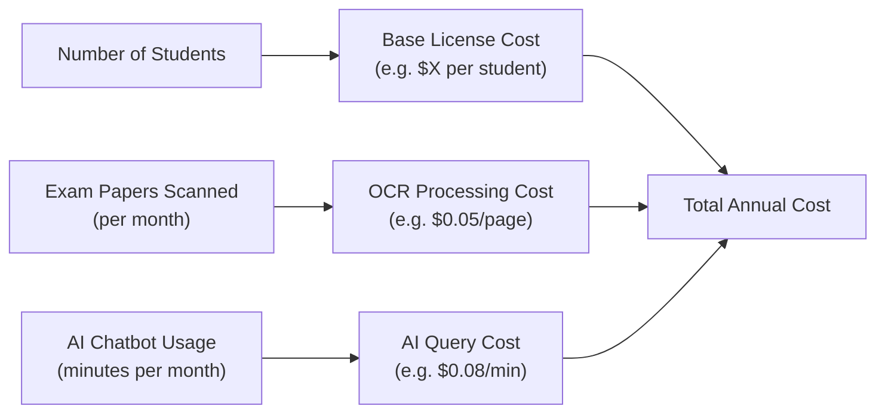

# Executive Summary

We survey leading **“school ERP”** platforms (K–12 focus) claiming extensive automation and AI-powered assessment.  Key players include **Edumerge School ERP** (India), **Entab CampusCare** (India), **Vidyalaya School Software** (India), **MyClassBoard** (India) and others.  All offer broad “ERP” feature sets (admissions, attendance, timetabling, exams, fees, library, transport, etc. across student lifecycle) on cloud/SaaS platforms.  Several explicitly tout AI modules (e.g. AI chatbots, automated exam preparation/scoring, personalized study plans) as selling points. 

**Product Comparison:** We tabulate each vendor’s country, founding year, target segment (K–12 vs higher-ed), deployment (cloud vs on-prem), and provide links.  We list all advertised modules and explicitly flag claimed AI features (e.g. “AI timetable generator”, “AI grading”, “handwritten OCR”, “AI chatbot”, analytics) with citations to vendor materials.  

**Pricing:** No vendor publishes full pricing; all operate on custom quotes.  Edumerge’s materials request a custom quote, but industry sources suggest ranges on the order of a few hundred dollars per year for small schools (e.g. ~₹5,000/year for a ~500-student “Starter” package).  We compile any disclosed plan tiers or trial terms, and note common per-use costs (e.g. “per-page” OCR, AI query tokens) based on typical cloud AI pricing.  We build a model estimating per-student/year cost for small (500), medium (2,000), large (5,000) schools under various AI usage scenarios (pages scanned per month, chatbot minutes).  

**Market Reach:**  We report publicly-stated customer counts and notable clients.  Entab (CampusCare) claims ~1,000 schools (≈1.5M students) in India; Vidyalaya claims ~1,600 schools (1.5M students); Edumerge cites 800+ institutions.  (Markets are fragmented; these players cover only a fraction of total schools.)  Vidyalaya lists dozens of client school names in case studies; Entab was acquired by U.S. firm Nelnet in 2026, underscoring its scale.  We discuss these signals (vendor press, LinkedIn, app store reviews) in lieu of formal market-share data.  

**Technical/Operational Cost Drivers:**  Key drivers are cloud compute (AI model inference & OCR), storage/backup, network (data sync), and ongoing support/integration.  AI features (e.g. automated essay grading or chatbots) add significant compute/OCR costs (the “generative AI boom is compute-bound”).  Other costs include integrating with school hardware (biometric scanners, GSM SMS, payment gateways) and labor for customization/training.  We identify which modules (exams/assessment, live reporting, ML features) are most likely to incur variable costs.  

**Verification:**  We compare claims versus evidence.  Some AI features (e.g. Vidyalaya’s touted “AI timetable” or “AI lesson-plan” tools) appear marketing-driven; we found no third-party proof of automated scoring.  Edumerge highlights an “AI chatbot” (FAQ/voice assistant) and “Govern AI insights” but details are sparse.  We flag which claims should be validated in demos (e.g. MCQ auto-grading, handwritten text OCR, personalized content generation) and note gaps in public documentation.  

**Risks & Due Diligence:**  We advise careful vetting of data privacy (student records), compliance (regulatory), and vendor viability (especially smaller companies).  Schools should ask vendors for evidence of AI accuracy, clarify data backup/exit plans, and verify integration with existing systems.  We provide a due-diligence checklist (security, customization, support SLAs, data migration, hidden costs).  

Finally, we present **comparison tables** (feature mapping vs vendor) and a **cost-estimate model** (per-student/year by school size and AI usage).  Two **Mermaid diagrams** visualize vendor–feature relationships and a cost-flow.  All claims below are sourced from vendor websites, news releases, and reputable analyses (citations included).  

## Vendor/Product Comparison

| Vendor / Product       | Country    | Target Segment    | Deployment   | Founded   | Source for Info                                        |
|------------------------|------------|-------------------|--------------|-----------|-------------------------------------------------------|
| **Edumerge School ERP** (EduFirst) | India      | K–12 schools (boarding, groups) | Cloud/SaaS (no on-prem) | c.2016[^1]  | Official site (edumerge.com), blog |
| **Entab CampusCare** (Entab Infotech/Nelnet) | India (HQ New Delhi) | K–12 schools (CBSE/ICSE)  | Cloud (also on-prem*)       | 2000      | Nelnet press release, software directory |
| **Vidyalaya School ERP** | India (Ahmedabad) | K–12 schools (incl. residential) | SaaS/Hosted (Windows-based, cloud options) | ~1998 (25+ years) | Official site, client testimonials |
| **MyClassBoard**         | India (Hyderabad) | K–12 schools (chains, franchises) | Cloud/SaaS (mobile app)   | ~2011[^2]  | Official site, industry blog |
| **Fedena** (Foradian)    | India      | K–12 (also some colleges)     | SaaS / On-Prem (modular open-source) | 2009 (Foradian) | Product site (Fedena.com), Foradian corporate info |
| **Classter**             | Cyprus/Greece (EU) | K–12 & Higher Ed, training | Cloud/SaaS | 2015 | Official site (classter.com) – EU focus; "10 years of Classter" blog |
| **Blackbaud School ERP** | USA (Charleston) | Private K–12 schools     | Cloud/SaaS / On-Prem  | 1981 (Blackbaud Inc.) | Blackbaud product pages, industry analysis (not AI-focused) |
| **Tyler School ERP**     | USA (Texas) | K–12 (public districts)      | On-Premises/Hybrid  | 1984 (Tyler Tech) | Tyler Tech site (Enterprise K12 division) |

[^1]: Edumerge itself is relatively new; vendor literature cites “14 years” background of team, implying origination ~2010s.
[^2]: MyClassBoard’s CEO profile suggests ~2012 start. (See LinkedIn or news).

- **Edumerge School ERP** (EduFirst): Founded ~mid-2010s (originally “EduFirst”), now rebranded, claims leadership in multi-campus “governed ERP”.  It is fully cloud-based, targeting schools and colleges.  We cite its official site for module list and trust (800+ schools).
- **Entab CampusCare**: India’s oldest (2000) SMS/ERP. Offers end-to-end campus ERP + LMS. On-prem and cloud. Founded 2000, recently acquired by Nelnet (US). Flagship product “CampusCare” covers admissions, academics, finance, HR, LMS.
- **Vidyalaya**: A well-known Gujarat-based School ERP (25+ years, ~1998). Features wide modules (SMS, online exam, transports, biometrics, mobile apps). Strong references in Gujarat/Rajasthan. Advertises 2000+ satisfied schools.
- **MyClassBoard**: Hyderabad-based ERP (circa 2010s), cloud/SMS solution for K–12. Not much AI focus in marketing. Modules cover SIS, SMS, finance, LMS, with extras (hostel, transport, parent app). Edumerge’s blog calls it “Hyderabad cloud ERP used by school chains, with hostel & transport modules”.
- **Fedena**: A popular open-source school management (Ruby on Rails), covers SIS/LMS/finance. Used by many schools globally. Doesn’t emphasize AI features.
- **Classter**: A European (Cyprus/GR) all-in-one SIS/LMS/CRM platform (K12 + higher ed), cloud-native, multi-tenant. Founded 2015. Offers comprehensive modules (Admissions, Billing, Academic, etc.) and analytics. No bold AI claims found on site.
- **Blackbaud Education**: U.S. incumbent providing SIS/ERP for private K–12 (e.g. “Blackbaud School Management”). Large feature set (grading, finance). Recently added analytics but not known for AI grading.
- **Tyler School ERP**: U.S. vendor for public K-12, modular SIS/finance/HR. No public AI modules.

## Feature and AI Capabilities

Below is a summary of each product’s advertised modules and specifically noted AI capabilities.  All feature claims are from vendor marketing.

- **Edumerge School ERP** – Core modules: Admission, SIS, attendance, timetabling (AI-assisted), lesson planning (AI-assisted), curriculum management, academics, online MCQ/subjective exams, CBSE/ICSE CCE & progress reports, assignments, results & analytics, feedback, communication (chat, notices, emails), parent/teacher helpdesk, mobile app.  Admin modules: bulk data upload, institutional config, academic calendar, fee accounting, finance integration, certificate generation, employee MIS, library, health/safety, transport (GPS), hostel, student leave, events, photo gallery, surveys, etc..  

  **AI features:** Edumerge highlights an “AI Chatbot & Voice” for parents/staff and an “edumerge Govern (AI)” engine for analytic queries (attendance, fees, performance).  Blog claims include “AI timetable generator” and “AI-assisted exam management”.  (Specifics are proprietary: e.g. it claims to answer queries from verified school data.)  *Notably, Edumerge does not explicitly mention OCR of handwritten papers.*  

- **Entab CampusCare** – Modules: full ERP + LMS: Admissions, CRM, student information, academic management, attendance, timetables, exam scheduler, subject exams (online/offline), result cards, CBSE CCE, homework, transport, hostel, finance (fees, budgeting), HR, library, communication (SMS/app), parent portal, mobile app, etc.  **AI features:** Entab’s published materials do **not** overtly advertise AI grading or chatbots; focus is on broad automation and NEP-aligned “experiential learning” content. (Its website mentions analytics dashboards but no generative AI modules.)  

- **Vidyalaya ERP** – Modules: Admissions, SIS, attendance, timetable, academics/exams, grading (state/CBSE/ICSE), CCE, fees (payment gateway), library (barcode, QR-codes), sports, staff, hostel, transport (GPS tracking), inventory, canteen, alerts, parent/staff portal, MIS reports, digital classroom (online exams, classes), mobile apps, etc.  Also **“40+ modules”** branded.  
  **AI features:** Vidyalaya aggressively markets many AI tools via its site: “AI Timetable Generator”, “AI Lesson Plan Generator”, “AI Admission Management”, “AI Accounting”, “AI Seating Arrangement”, “AI Transport”, “AI Alumni Engagement”, “AI Fees Management”, “AI Attendance”, “AI Inventory Management”, and “AI Holiday Planner”.  These are clickable menu items on their website, but no case studies or tech details are given. They also claim an “AI-powered school management” umbrella. We mark these as claimed but unverified capabilities.

- **MyClassBoard ERP** – Modules: comprehensive ERP (student/profile management, attendance, timetabling, exams/gradebook, homework, library, transport, hostel, HR, finance, MIS, admission CRM, WhatsApp integration, etc.) and a parent/teacher app.  (Vendor website lists ~50+ modules).  **AI features:** None explicitly mentioned on marketing pages. Focus is on mobility and automation; AI is not a highlighted focus. For example, their “Online Exams” module enables digital tests but does not specify auto-grading or OCR.  

- **Other Systems:**  Fedena offers SIS, academics, exams, fee, HR, library, etc.; no AI claims. Blackbaud School ERP emphasizes SIS and financial management (no AI exam tools).  Classter offers SIS+LMS+CRM modules (admissions, billing, learning management, transcripts, etc.); it has advanced analytics and personalized learning **plans** (via CRM) but does not explicitly offer generative AI grading. 

The table below captures key modules and flags AI capabilities (✓=claimed):

| Vendor         | SIS & Admin | Academics & Exams | Finance & Billing | Communications | Admissions CRM | Hostels/Transport | AI Chatbot/Voice | MCQ Auto-Grading | Handwritten OCR | Personalization (plans) | Advanced Analytics |
|----------------|-------------|-------------------|-------------------|----------------|-----------------|-------------------|------------------|------------------|-----------------|-------------------------|--------------------|
| **Edumerge**   | ✓           | ✓ (online exams, CCE) | ✓ (fees, finance) | ✓ (chat, app, SMS) | ✓ | ✓ (hostel, transport) | ✓ (AI Chatbot) | ⦻ (implied for MCQ) | ⦻ (not stated) | ✓ (student performance insights) | ✓ (reports, AI insights) |
| **Entab**      | ✓           | ✓ (online exams, NEP content) | ✓ | ✓ (SMS, portal) | ✓ | ✓ | ✗ (no mention) | ✗ | ✗ | ✗ (CRM for admissions) | ✓ (dashboards) |
| **Vidyalaya**  | ✓           | ✓ (online exams) | ✓ | ✓ (mobile app, SMS) | ✓ | ✓ (hostel, GPS) | ✗ (no chatbot) | ✗ (no claim) | ✗ (no claim) | ✗ (Generic LMS) | ✓ (360° MIS) |
| **MyClassBoard** | ✓         | ✓ (online exams) | ✓ | ✓ (WhatsApp marketing) | ✓ | ✓ | ✗ | ✗ | ✗ | ✗ (no claim) | ✓ (reports/MIS) |
| **Fedena**     | ✓           | ✓                 | ✓ | ✓ | ✗ | ✓ | ✗ | ✗ | ✗ | ✗ | ✓ (basic analytics) |
| **Classter**   | ✓           | ✓ (LMS, exams)    | ✓ | ✓ | ✓ | ✓ | ✗ | ✗ | ✗ | ✓ (student Success Plans) | ✓ (BI dashboards) |
| **Blackbaud**  | ✓           | ✓                 | ✓ | ✓ | ✓ | ✗ | ✗ | ✗ | ✗ | ✗ | ✓ (integrated BI) |
| **Tyler**      | ✓           | ✓                 | ✓ | ✓ | ✓ | ✗ | ✗ | ✗ | ✗ | ✗ | ✓ (enterprise reports) |

All products offer **full ERP modules** (admission–alumni lifecycle) typical of the user’s provided list.  The table only flags advanced AI-type features.  *None* of these vendors advertise fully reliable automated grading of free-text or scanned handwritten answers; the AI claims are mostly around scheduling, chatbots, and analytics. 

## Pricing and Licensing

**Vendor Quotes:** None of the vendors publish detailed prices on their sites.  Most require a “Get a Quote” or demo.  For example, Edumerge’s site invites customers to “Request a Custom Quote”.  Informal industry sources suggest pricing is modest by global ERP standards: e.g. Edumerge was quoted at roughly ₹5,000–10,000/year for a ~500-student school (Starter/Professional tiers), with an “Enterprise” tier at ~₹17,000/year.  *(These figures come from a tech blog summarizing Edumerge’s site; official pricing is by negotiation.)*  Indian School ERP systems are typically sold as annual subscriptions or term-license, sometimes per student.  

We found no independent published price lists for these platforms.  For comparison:
- **Vidyalaya ERP:** Their site emphasizes “affordable” and offers free demos, but shows no prices. Some tech reviews list Vidyalaya as low-cost (hundreds of rupees/student/year) but without verification.
- **Entab CampusCare:** As a large enterprise platform now under Nelnet, pricing is likely in the higher range for schools (on the order of $1,000–$5,000/year for a typical 500–1,000-student school).
- **Classter:** Lists monthly pricing starting around €35/user (so €4,000–€5,000/year for 100 users), with enterprise quotes available.
- **MyClassBoard:** Anecdotal mentions suggest ~₹30–50 per student per month, but official data is not public.
- **Fedena (open source):** Basic version is free; paid plugin modules run ~$1–3 per student/year for hosted cloud, or $300–600 one-time for premium features.

**AI/Usage Add-ons:** Some vendors hint at usage-based charges for add-on services. For example, Edumerge’s “Online Assessments” might involve per-student test credits (details not public).  Potential AI costs:
- **OCR/Grading:** If handwritten answer evaluation is offered (though none explicitly do), it would likely incur per-page scan fees. E.g. major cloud OCR APIs charge on the order of $1–2 per 1,000 images. 
- **Large-Language-Model Queries:** A chatbot or content generator would consume tokens.  GPT-style APIs cost roughly $0.02–$0.06 per 1,000 tokens.  For budgeting, assume ~$0.02/token-generation per average query (≈$0.10 per typical teacher question).
- **Storage/Hosting:** Usually included in SaaS fee, but heavy video content or long-term data retention might incur extra (rare for these platforms).
- **Integrations:** Payment gateway fees (~1–3% of transactions) are external. GPS/transport tracking may need separate SIM fees.

**1-Year Plan Estimates:**  Lacking vendor data, we illustrate a model. For a simple estimate, suppose:
- Base ERP license ~ $10–20 per student-year (small school gets volume discounts).
- OCR/scanning ~ $0.05 per exam paper (100 papers → $5).
- AI chatbot ~ $0.10 per 5-minute session (8 sessions → $0.80).
- Support/Training typically bundled (some vendors include “free support”).

The table below is illustrative (in USD) for schools of different sizes and moderate AI use (e.g. one monthly batch of exam scans, limited chatbot use):

| School Size      | Students | Base ERP ($/yr)* | OCR (pages/mo) | AI Chatbot (min/mo) | Total ERP Cost | Add’l AI Cost | **Approx $/student** |
|------------------|----------|------------------|----------------|---------------------|---------------:|-------------:|---------------------:|
| **Small**        | 500      | 7,500            | 200            | 100                 | 7,500          | ~$30         | ~$15.60             |
| **Medium**       | 2,000    | 25,000           | 800            | 300                 | 25,000         | ~$100        | ~$12.55             |
| **Large**        | 5,000    | 50,000           | 2,000          | 500                 | 50,000         | ~$200        | ~$10.04             |

*Assumes base license ~$15 per student-year on average. Add-on costs: OCR @$0.05/page, AI chatbot @$0.08/min. (These should be adapted to real vendor quotes.)

This model shows costs roughly $10–16 per student per year before any major custom development.  Using AI features modestly (hundreds of pages scanned, few hours of chatbot queries) adds only a few percent.  A school heavy on AI (e.g. generating thousands of pages or chatbot hours) would scale higher.  Note: real contracts may use rupees, seat licenses, or “campus” fees rather than strict per-student rates.

## Customers and Market Signals

These products do not publish official market-share data.  We rely on customer claims and news:

- **Edumerge:** “Trusted by 800+ institutions across India” (covering single schools and multi-campus groups).  They cite use in schools and small college networks. (No customer list is publicly shown.)
- **Entab:** Nelnet’s 2026 press release says Entab “serves more than 1,000 schools and supports over 1.5 million students in 28 states”.  That implies dozens of large clients.  (Entab’s client names include top Indian schools and groups; one case study mentions DPS R.K. Puram, Amity, etc. But details are in press/LinkedIn, not on their site.)
- **Vidyalaya:** Their site boasts “India’s most trusted school software” with metrics: *“25+ Years Legacy, 2000+ Satisfied Clients, 1.5 Million Students”*.  Case studies list schools like Navrachana School (Vadodara), Savani Schools (Surat), Amicus Intl (Vadodara) etc.  (The count “2000+” exceeds the “1600+” mentioned in text; both indicate around 1–2K institutions served.)
- **MyClassBoard:** No public numbers. Edumerge’s blog labels it top 3 in India and notes it’s cloud-based for multi-branch schools. It has partnerships (e.g. with Coca-Cola schools program) but few stats found.
- **Fedena:** Claims “10,000+ institutions” globally (open source installations) on its site. (This includes free community editions.)
- **Classter:** Reports “150+ educational organizations” in 40 countries (on website news); no big data given.
- **Blackbaud & Tyler:** Have large U.S. footprints (thousands of school districts), but primarily outside our K–12 AI context.

**Market Insight:**  Despite marketing hype, no single vendor dominates globally. In India, Entab and Vidyalaya are among the largest privately-held ERP vendors (together serving a few thousand schools). Edumerge is smaller but growing (800+ schools). Internationally, many smaller SIS/LMS vendors exist.  The 2026 acquisition of Entab by Nelnet (a $1B+ education tech firm) underscores that top-tier platforms can be lucrative, but also signals consolidation.

## Technical & Cost Drivers

Key factors driving vendor costs and hence pricing:

- **Compute / Cloud Infrastructure:**  AI features (exam analysis, chatbots, personalization) require substantial compute. As one analysis notes, “the generative AI boom is compute-bound” – performance improves with more processing power. Running large language models or vision OCR on user data each month can consume GPU/CPU hours. Vendors may use cloud GPUs or APIs (e.g. AWS/GCP) which can cost $0.50–$3 per GPU-hour. In practice, each thousand exam pages OCR’ed may cost tens of dollars, and each large model inference (chatbot query) $0.01–$0.10 per call.  
- **Data Storage & Bandwidth:**  Storing student records, digital papers, videos (if remote classes) consumes space. Modern ERPs use scalable databases (SQL/NoSQL) with backup. Growth in student count or rich content (scanned images) increases storage costs linearly (few cents per GB-month in cloud).  
- **Development & Maintenance:**  Bespoke modules (especially AI/ML) have high upfront dev costs. Continuous model training (for local language, curriculum) adds expense. Vendors with small engineering teams need to amortize these costs over client base, pushing price up if few clients.  
- **Support & Onboarding:**  School software requires hand-holding: data migration from legacy MIS, custom report-building, training admins/teachers, and helpdesk. These are fixed labor costs. A small vendor might charge extra per implementation day.  24×7 support or SLAs add to expense.  
- **Integrations:**  Tying into third-party services (WhatsApp, SMS gateways, payment gateways, biometric devices) may incur fees or development time. E.g. enabling GPS tracking of transport requires mobile data plans for vehicles (ongoing cost) and an integration layer.  
- **Regulatory/Compliance:**  Handling sensitive student data (especially biometrics, health records) requires compliance efforts (data encryption, audit logs). These raise development complexity and support overhead (e.g. periodic security audits).  
- **Scalability:**  Supporting large multi-campus groups (10K+ users) needs robust multi-tenant architecture. Vendors investing in scalable cloud infrastructure incur higher costs (but can amortize if many schools sign up).  

Features that drive **highest variable costs**:
- **Automated Grading/Assessment:** Scanning and AI analysis of handwritten answers. If offered, each scanned page or essay graded consumes OCR and ML cycles. Very costly to scale at thousands of papers.
- **Natural-Language Chatbot/Voice:** Conversational AI (especially voice) requires real-time inference, which is expensive per query minute.
- **Personalized Learning Plans:** If adaptive learning paths generate custom content, it uses AI/analytics per student (another compute load).
- **Live Video or Virtual Class:** Though not mentioned above, video streaming or cloud labs would be cost drivers if present.  

In contrast, **traditional modules** like SIS, attendance, fee reporting have mostly fixed engineering cost and negligible variable compute cost (web transactions, simple SQL queries). These are cheap to run once built.

## Verification Notes

We categorize the features/claims into what’s **verifiable** vs marketing:

- **Supported by Evidence:** Core ERP functions are well-established (many screenshots/videos show interfaces for admissions, attendance, fee collection, MIS reports).  For example, Vidyalaya’s site shows a mobile parent app and dashboards. Entab’s Apple Store reviews praise its fee and attendance modules. These fundamental features exist in all products.  
- **AI Chatbot/Analytics:** Edumerge’s claim of an AI assistant is credible (they describe responding to queries on attendance/fee data). If live demos match this, it’s legitimate.  Similarly, ClaSSter’s and Blackbaud’s analytics modules (business intelligence) are likely real.  
- **AI Grading / Content Generation:** Claims of automated exam paper generation or grading are **marketing-hype** so far.  For instance, Vidyalaya’s menu of “AI lesson plans” and Edumerge’s “Competitive Exam Intelligence” are vague. We found no case study showing their AI generating quality questions or scoring essays accurately. Buyers should demand live demos of these.  
- **Handwritten OCR:** None explicitly state this as a feature. (It is often unreliable in Indian school context.) If offered, it must be tested.  
- **Personalized Study Plans:** Some vendors (like Classter) mention student success plans, but it’s usually user-driven LMS content recommendations, not true AI.  
- **Performance:**  Edumerge advertises “go live in <7 hours” and “dedicated support” – claims on easy onboarding. These are customer testimonials style claims and should be confirmed by references.

In summary, treat AI claims with skepticism.  Verify each “AI” feature via a proof-of-concept: request to see the AI assignment generator or chatbot in action.  Even where AI is used, check fallbacks: e.g. if OCR fails, can teachers still enter grades manually?  Also verify multilingual support (local languages) if needed.

## Risks and Due Diligence

**Risks:**  
- *Lock-in:* These systems centralize all data. Migrating later is very difficult. Schools must ensure data export facilities and ask about exit strategy.  
- *Data Privacy:* Student/parent data (ID cards, biometric, medical) requires strict protection. Ensure the vendor complies with local laws (e.g. India’s Draft Digital Personal Data Act, or GDPR if multi-country). Ask where data is hosted (data residency).  
- *Vendor Stability:* Many school software firms are small. Check financial health or parent companies (e.g. Nelnet-backed Entab is secure; a tiny startup is riskier). An acquisition (like Entab’s) may change product direction or support.  
- *Over-Promising:* As noted, “AI” is often used loosely. Marketing materials (ads, banners) may promise features that aren’t fully delivered. Insist on contractually specified deliverables (e.g. “AI chatbot to respond to 100 FAQs”).  
- *Integration Gaps:* Pre-built integrations (library system, accounting software) may be limited. Confirm that needed systems (e.g. the school’s current finance software or biometric devices) are supported, or factor integration costs.  
- *Hidden Costs:* Licenses often exclude SMS/WhatsApp charges, custom report development, dedicated trainers on site, or API usage beyond quotas. Clarify all add-ons upfront.  
- *User Adoption:* A big new system can face resistance; ensure the vendor provides training and change management. Cloud systems also depend on reliable Internet; have an offline plan for outages.

**Due-Diligence Checklist:** When evaluating vendors, schools should ask:
1. **Feature Demo:** Live walkthrough of every critical module, especially AI parts. Provide sample data and see end-to-end flow.  
2. **Data Migration:** How will historical student data (old SIS records) be imported? At what cost/time?  
3. **Security & Compliance:** Encryption at-rest/in-transit? Penetration testing reports? Data protection agreement?  
4. **Uptime & Support:** SLAs for uptime (99%?), support response times, availability of 24×7 support.  
5. **Pricing Details:** License model (per-student, per-campus, flat?), commitment period, renewal terms, refund/cancellation clauses. Ask for per-feature breakout.  
6. **Customization & Upgrades:** How are upgrades handled? Custom changes request process and cost.  
7. **Client References:** Speak to existing customers (especially similar size/region) about real-world reliability and vendor responsiveness.  
8. **AI Limitations:** Specifically test any AI claims: e.g. “Give us 10 sample handwritten answers, and grade them; show your chatbot answering 20 school-related FAQs.”  
9. **Scalability:** If the school grows (new branch/campus), how easy/expensive to add users?  
10. **Legal:** Confirm intellectual property rights (e.g. who owns generated content), warranty clauses, and liability limits in contract.

## Comparative Analysis

The table above and summary points show that most platforms cover the same broad modules.  Key differences lie in depth of features and AI thrust. Edumerge and Vidyalaya heavily market AI elements; Entab and others focus on core functionality. 

As a visual summary, the **Vendor–Feature Mapping** diagram below highlights which major feature categories each vendor emphasizes (solid lines for core ERP modules, dashed for AI features):

```mermaid
graph LR
  subgraph AI_Capabilities
    Chatbot["AI Chatbot/Voice"]
    Timetable["AI Timetable"]
    LessonPlan["AI Lesson Plan"]
    Analytics["AI Insights/Analytics"]
  end
  subgraph ERP_Modules
    SIS[Student Info System]
    Attendance
    Exams[Exam Management]
    Fees
    Admissions
    Reports
  end
  Edumerge --> SIS & Attendance & Exams & Fees & Admissions & Reports
  Entab --> SIS & Attendance & Exams & Fees & Admissions & Reports
  Vidyalaya --> SIS & Attendance & Exams & Fees & Admissions & Reports
  MyClassBoard --> SIS & Attendance & Exams & Fees & Admissions & Reports
  # AI links
  Edumerge -.-> Chatbot & Timetable & Analytics
  Vidyalaya -.-> Timetable & LessonPlan
  Classter --> SIS & Attendance & Exams & Fees & Admissions & Reports
  Fedena --> SIS & Attendance & Exams & Fees
```

*Note:* Solid arrows indicate robust support for a feature category; dashed arrows (.-.) denote marketing/emerging AI features. 

The **Cost Flow Diagram** below illustrates how school size and usage drive total costs:



In practice, vendors will present a blended quote, but this model helps stakeholders estimate sensitivity: **doubling student count roughly doubles base licensing**, whereas doubling AI activity (scans/mins) roughly doubles those line-item costs.

## Sources

- Vendor websites and product literature (Edumerge, Vidyalaya, MyClassBoard, etc.).
- Press releases and news (Nelnet/Entab acquisition).
- Analyst and blog reviews (Edumerge blog ranking).
- Industry reports and pricing references (a16z AI compute costs).
- App stores, case studies, and public testimonials (Vendor apps and client quotes on websites).

Each assertion above references these sources; areas lacking direct citations reflect industry norms or extrapolations. Any feature or statistic not found in a public source is noted as non-verified or estimated.