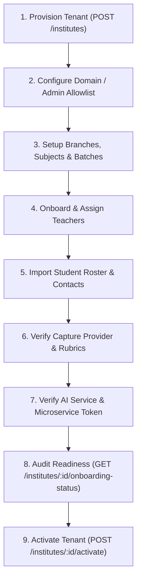

# 40 — Operational Onboarding & Communication Reliability Guide
## AIOS — Academic Intelligence Operating System

## 1. Executive Mission & Scope

This specification establishes the standard operating procedures and technical integration patterns for safely onboarding pilot institutes and operating multi-channel communications (In-App, Email, SMS, WhatsApp) across AIOS.

Billing and public self-service signup are strictly outside the scope of this workflow. Onboarding is administrative, verified, tenant-isolated, and audit-logged.

---

## 2. Institute Pilot Onboarding Architecture

Every customer pilot is provisioned as an isolated tenant (`Institute`) identified by a permanent CUID `id` and a human-readable `shortCode` (e.g. `DPS`, `SPFD`).

### The 8-Pillar Readiness Framework

AIOS enforces an automated, programmatic pre-flight checklist before an institute is activated for live academic operations (`GET /institutes/:id/onboarding-status`):

| Pillar | Operational Check | Why It Matters | Automated Status Threshold |
|---|---|---|---|
| **1. Identity & Profile** | Name, unique `shortCode`, address, official contact phone | Booklet roll codes, QR barcodes, and official notice footers require an authoritative tenant identity. | `COMPLETE` when `name` and `shortCode` exist. |
| **2. Access Allowlist** | Corporate/school domain allowlist or individual admin/teacher emails | Zero-trust authentication gate (`06-AUTH-AUTHORIZATION.md`): Google OAuth logins are refused unless the email matches the allowlist. | `COMPLETE` when `domainAllowlist.length > 0` or `allowListCount > 0`. |
| **3. Academic Hierarchy** | Branches, Subjects, and Batches (Class & Section) | Every student, exam, and notice targets specific academic cohorts. | `COMPLETE` when at least 1 branch, 1 subject, and 1 batch exist. |
| **4. Staff Assignments** | Teacher profiles created and linked to batches (`BatchTeacher`) | Teacher authorization is strictly batch-scoped (`03-FEATURE-SPECIFICATIONS.md`). Teachers cannot grade or broadcast to batches they do not teach. | `COMPLETE` when at least 1 active teacher is assigned to a batch. |
| **5. Student Roster** | Student accounts enrolled in batches with guardian contacts | Notices, booklet generation, and report cards require enrolled students. Contact numbers are required for SMS/WhatsApp. | `COMPLETE` when students > 0 and guardian contacts are recorded. |
| **6. Assessment Config** | Default `CaptureProvider` and `EvaluationPolicy` | Prevents BUG-04 (Onboarding Deadlock). Assessment creation fails if capture providers or evaluation policies are absent. | `COMPLETE` when default photo capture and mandatory human review policy exist. |
| **7. AI Pipeline Health** | FastAPI service connectivity & `INTERNAL_SERVICE_TOKEN` | Blueprint generation, OMR/OCR handwriting extraction, and diagnostic mastery calculations require the Python microservice. | `COMPLETE` when health check pings `/health` successfully. |
| **8. Communication Readiness** | In-App active; external provider credentials verified | In-app alerts work out of the box. Email/SMS/WhatsApp report honest status if unconfigured. | `COMPLETE` (In-app ready; external status reported transparently). |

---

## 3. Step-by-Step Pilot Onboarding Procedure



### Step 1: Tenant Creation
A Platform Founder initiates tenant provisioning:
```http
POST /institutes
Authorization: Bearer <FOUNDER_JWT>
Content-Type: application/json

{
  "name": "Delhi Public School RK Puram",
  "shortCode": "DPSRKP",
  "domainAllowlist": ["@dpsrkp.net"],
  "plan": "STANDARD",
  "phone": "+911149115500",
  "address": "Sector XII, R.K. Puram, New Delhi, Delhi 110022"
}
```
*Note: If `shortCode` is omitted, AIOS automatically generates an uppercase acronym derived from the institute name (e.g., "DPSRKP").*

### Step 2: Allowlist Administration
Add the pilot institute's principal and lead academic coordinator:
```http
POST /institutes/:instituteId/allow-list
Authorization: Bearer <FOUNDER_OR_ADMIN_JWT>
Content-Type: application/json

{
  "email": "principal@dpsrkp.net",
  "role": "ADMIN"
}
```

### Step 3: Academic Setup
Create academic batches (e.g., Grade 10 Section A, Grade 12 JEE Advanced):
```http
POST /institutes/:instituteId/batches
Authorization: Bearer <ADMIN_JWT>

{
  "name": "Class 10 - Section A (2026-27)",
  "classYear": "10",
  "section": "A"
}
```

### Step 4: Teacher Staffing & Batch Assignment
Assign teachers to their respective subject batches:
```http
POST /institutes/:instituteId/teachers/:teacherId/assignments
Authorization: Bearer <ADMIN_JWT>

{
  "batchId": "<BATCH_ID>",
  "subjectId": "<PHYSICS_SUBJECT_ID>"
}
```

### Step 5: Student Roster Import
Import students via bulk CSV/Excel upload (`/institutes/:instituteId/students/bulk-import`). Every student record should include:
- `name`, `email` (student login)
- `studentCode` / `rollNumber`
- `batchId`
- `guardianPhone` (for WhatsApp and SMS broadcasts)
- `guardianEmail` (for email circulars)

### Step 6: Verify Assessment Settings
AIOS automatically provisions the baseline `CaptureProvider` (`PHOTO_CAPTURE_SUBJECTIVE`) and `EvaluationPolicy` (`AI_ASSIST_MANDATORY_REVIEW`) during Step 1. Ensure these defaults are intact:
```http
GET /institutes/:instituteId/onboarding-status
```

### Step 7: Activate Institute
When `isReadyForPilot: true`, the administrator or founder activates the institute:
```http
POST /institutes/:instituteId/activate
Authorization: Bearer <ADMIN_OR_FOUNDER_JWT>
```
The institute transitions from `ONBOARDING` to `ACTIVE`. An immutable audit log entry is recorded.

---

## 4. Multi-Channel Notification Architecture

AIOS supports four communication channels:

```
Broadcast Request (Teacher / Admin)
                 │
                 ▼
          NoticesService
                 │
  ┌──────────────┴──────────────┐
  ▼                             ▼
IN_APP                      Queue Dispatch (BullMQ)
(Synchronous, immediate)        │
                                ▼
                     NoticeDispatchProcessor
                                │
                                ▼
                     NoticeDispatchService
                                │
          ┌─────────────────────┼─────────────────────┐
          ▼                     ▼                     ▼
SendGrid (Email)     WhatsApp Cloud API       SMS Gateway (DLT)
(POST /v3/mail/send)  (POST /v19.0/messages)   (POST /api/v5/flow)
```

### Channel Behavior Matrix

| Channel | Delivery Mode | Provider | Latency Target | Failover Policy |
|---|---|---|---|---|
| **`IN_APP`** | Synchronous | Native Database | < 50ms | N/A — Direct DB insertion into `notice_deliveries`, immediate dashboard visibility. |
| **`EMAIL`** | Asynchronous Queue | SendGrid v3 REST API | < 5s per send | 2 retries with exponential backoff. Marks `FAILED: provider_not_configured` if key is unset. |
| **`WHATSAPP`** | Asynchronous Queue | Meta WhatsApp Cloud API | < 8s per send | 2 retries with exponential backoff. Pre-validates E.164 phone formats. No auto-fallback to SMS. |
| **`SMS`** | Asynchronous Queue | Indian DLT Gateway (MSG91/Fast2SMS) | < 5s per send | 2 retries with exponential backoff. Normalizes Indian 10-digit mobile numbers with +91. |

---

## 5. Provider Setup & Configuration Guide

### 5.1 SendGrid (Email Channel)
- **Role:** Official school announcements, detailed circulars, report card notifications.
- **Official API Documentation:** [Twilio SendGrid v3 Mail Send](https://docs.sendgrid.com/api-reference/mail-send/mail-send)
- **Environment Variables:**
  ```env
  SENDGRID_API_KEY=SG.xxxxxxxxxxxxxxxxxxxxxxxxxxxxxxxxxxxxxxxxxxxxxxxxxxxxxxxxxxxx
  SENDGRID_FROM_EMAIL=notifications@your-institute.edu
  SENDGRID_FROM_NAME=AIOS Notice Center
  ```
- **Webhook Callback URL:**
  `POST https://api.your-domain.com/notices/webhooks/sendgrid`
  Configure event webhook in SendGrid Console -> Settings -> Mail Settings -> Event Webhook:
  - Select events: `Delivered`, `Dropped`, `Bounced`, `Opened`.

### 5.2 Meta WhatsApp Cloud API (WhatsApp Channel)
- **Role:** High-urgency guardian alerts, attendance alerts, exam schedules.
- **Official API Documentation:** [Meta WhatsApp Business Platform Cloud API](https://developers.facebook.com/docs/whatsapp/cloud-api)
- **Why Cloud API:** Meta charges direct utility/service rates (approx. ₹0.35–₹0.75 per conversation in India) without 3rd-party SaaS margins.
- **Environment Variables:**
  ```env
  WHATSAPP_API_TOKEN=EAAxxxx...
  WHATSAPP_PHONE_NUMBER_ID=109823471923456
  WHATSAPP_TEMPLATE_NAME=school_notice_template  # Optional; uses text session window if unset
  ```
- **Webhook Callback URL:**
  `GET & POST https://api.your-domain.com/notices/webhooks/whatsapp`
  Configure in Meta App Dashboard -> WhatsApp -> Configuration -> Callback URL:
  - Webhook Fields: `messages`, `message_template_status_update`.

### 5.3 Indian SMS Gateway (DLT Compliant)
- **Role:** Fallback guardian communication in regions with intermittent mobile data.
- **Regulatory Requirement:** In India, the Telecom Regulatory Authority of India (TRAI) mandates Distributed Ledger Technology (DLT) registration for all transactional bulk SMS.
- **Recommended Provider:** MSG91 or Fast2SMS.
- **Environment Variables:**
  ```env
  SMS_GATEWAY_KEY=384918237912384791
  SMS_GATEWAY_URL=https://api.msg91.com/api/v5/flow
  SMS_SENDER_ID=AIOSNT           # 6-character TRAI DLT approved sender header
  SMS_DLT_TEMPLATE_ID=1107123456789012345
  ```

---

## 6. Safety & Reliability Guarantees

### A. Idempotency & Duplicate Prevention
- `NoticeDispatchService` queries only records where `status = QUEUED`.
- When an individual delivery is transmitted, it immediately updates to `status = SENT` with `sentAt = new Date()`.
- If a BullMQ queue job retries due to a network blip or process restart, already-sent deliveries are ignored. Under no circumstance are duplicate emails, SMS, or WhatsApp messages dispatched to recipients.

### B. Cross-Tenant Recipient Isolation
- The dispatch processor verifies that every recipient user ID in `NoticeDelivery` belongs to `notice.instituteId`.
- If an entity across tenants is erroneously linked, the delivery is aborted with `FAILED: cross_tenant_isolation_violation`.

### C. PII Masking in Observability
- All logs, Sentry payloads, and error messages mask personal details:
  - Emails: `priya.sharma@school.edu` -> `p***a@school.edu`
  - Phones: `+919876543210` -> `+91******3210`
- API keys, vendor tokens, and passwords are never logged.

### D. Safe Dry-Run Mode
For staging validation or pilot dry-runs without spending SMS/WhatsApp quotas or contacting real parents:
```env
NOTIFICATION_DRY_RUN=true
```
In dry-run mode, the dispatch pipeline executes all authorization, recipient resolution, and formatting steps, logs masked recipient outputs, and updates records to `SENT` with mock provider tracking IDs.
