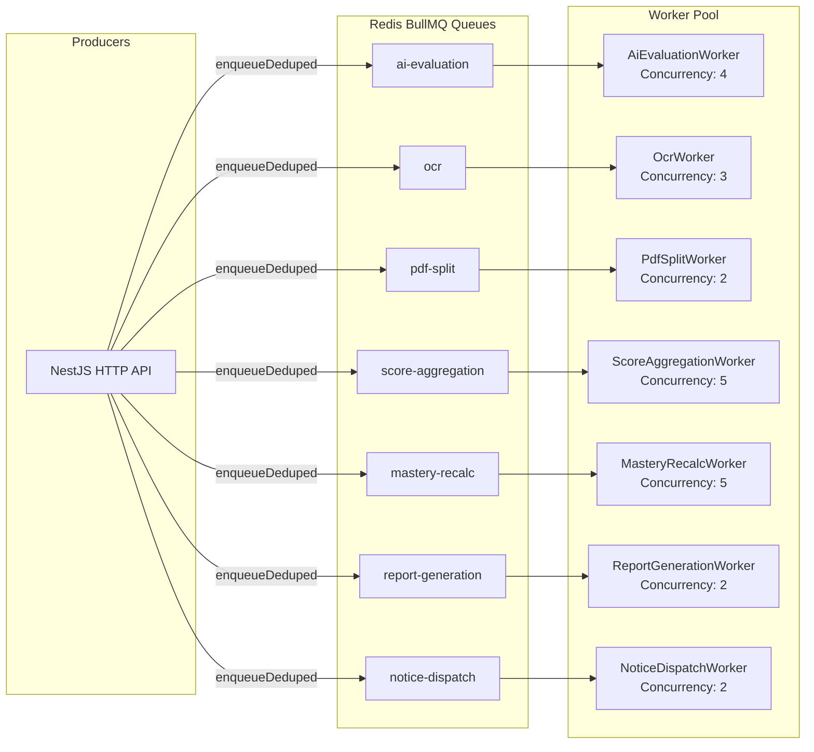

# SARVLEKH — Asynchronous Processing, Queue Isolation & Worker Reliability

**Author:** Distributed Systems & SRE Specialist  
**Date:** 2026-09-30  
**Target:** Robust Background Job Processing for 10,000+ Enrolled Students  
**Status:** Canonical Queue & Worker Reliability Specification  

---

## 1. Queue Architecture & Contracts

SARVLEKH relies on **BullMQ** backed by **Redis 7** for durable, decoupled background processing. The application partitions workloads into 6 distinct domain queues to ensure CPU-bound or external network-bound workloads cannot starve latency-sensitive operations:



---

## 2. Queue Configuration & Resource Policies

Configured canonically in [`apps/api/src/infrastructure/queue/queue-policy.ts`](file:///e:/sarvlekh/aios/apps/api/src/infrastructure/queue/queue-policy.ts):

| Queue Name | Workload Profile | Concurrency | Retries & Backoff | Completed Retention | Failed Retention (DLQ) |
| :--- | :--- | :---: | :--- | :---: | :---: |
| **`ai-evaluation`** | Network I/O (LLM Provider) | 4 | 3 attempts, exp. (1s delay) | `removeOnComplete: true` | 500 jobs / 14 days |
| **`ocr`** | Vision API / Heavy Payloads | 3 | 3 attempts, exp. (1s delay) | `removeOnComplete: true` | 500 jobs / 14 days |
| **`pdf-split`** | In-process PDF Page Render | 2 | 2 attempts, exp. (2s delay) | `removeOnComplete: true` | 500 jobs / 14 days |
| **`score-aggregation`** | High-Volume Database Upserts | 5 | 3 attempts, exp. (500ms delay)| `removeOnComplete: true` | 1,000 jobs / 7 days |
| **`mastery-recalc`** | EMA Formula Math (Node→Py) | 5 | 3 attempts, exp. (1s delay) | `removeOnComplete: true` | 200 jobs / 7 days |
| **`report-generation`** | CPU-Bound HTML/PDF Assembly | 2 | 3 attempts, exp. (1s delay) | `removeOnComplete: true` | 300 jobs / 14 days |
| **`notice-dispatch`** | Third-party Outbound Fan-out | 2 | 5 attempts, exp. (2s delay) | `removeOnComplete: true` | 500 jobs / 30 days |

### Why `removeOnComplete: true` Is Uniform
Every successful job creates a durable, permanent PostgreSQL record (`ScoreRecord`, `EvaluationVersion`, `MasteryScore`, `Report`, etc.). Retaining completed jobs in Redis duplicates data already in the database and consumes RAM unnecessarily. Furthermore, BullMQ rejects `queue.add()` if a job with the same ID exists in *any* state, including completed. Removing completed jobs allows legitimate re-evaluations and re-extractions to enqueue without collision.

---

## 3. Idempotency & Deduplication Engine

To protect against duplicate job submission during HTTP retries or network interruptions, all enqueuing passes through `enqueueDeduped()` in [`apps/api/src/infrastructure/queue/enqueue.ts`](file:///e:/sarvlekh/aios/apps/api/src/infrastructure/queue/enqueue.ts):

```typescript
export async function enqueueDeduped<T>(
  queue: Queue<T>,
  name: string,
  data: T,
  dedupeKey: string,
  opts: JobsOptions,
  logger: Logger,
): Promise<Job<T>> {
  try {
    return await queue.add(name, data, { ...opts, jobId: dedupeKey });
  } catch (err) {
    if (isJobIdCollision(err)) {
      logger.debug(`Job ${dedupeKey} already queued on ${queue.name} — collapsing duplicate.`);
      return (await queue.getJob(dedupeKey))!;
    }
    throw err;
  }
}
```

### Deterministic Dedupe Keys
- Report Generation: `jobKey('report', reportId)`
- AI Single Evaluation: `jobKey('single', responseId)`
- AI Batch Evaluation: `jobKey('batch', assessmentDeliveryId)`
- OCR Extraction: `jobKey('ocr', questionRegionId)`
- Mastery Recalculation: `jobKey('mastery', `${studentProfileId}-${sortedTopicIds.join('_')}`)`

---

## 4. Failure Handling, Dead-Letter Alerts & Replay

### Dead-Letter Alert Pipeline
When a background job exhausts all configured retries, BullMQ's `@OnWorkerEvent('failed')` handler routes through [`reportDeadLetter()`](file:///e:/sarvlekh/aios/apps/api/src/shared/logging/dead-letter.ts):

1. **Structured Log:** Logs complete job context, attempt counts, stack trace, and entity identifiers.
2. **Sentry Notification:** Emits a high-priority exception tagged with:
   - `queue: string`
   - `jobId: string`
   - `deadLettered: 'true'`
   - `extra: context`

### Safe Dead-Letter Replay Procedure
To replay dead-lettered jobs in an operational recovery scenario:

```typescript
// scripts/replay-dead-letters.ts
import { Queue } from 'bullmq';

async function replayQueue(queueName: string) {
  const queue = new Queue(queueName, { connection: { host: process.env.REDIS_HOST, port: 6379 } });
  const failedJobs = await queue.getFailed(0, 500);
  console.log(`Found ${failedJobs.length} dead-lettered jobs in ${queueName}`);

  for (const job of failedJobs) {
    console.log(`Retrying job ${job.id} (originally failed: ${job.failedReason})`);
    await job.retry();
  }
}
```

---

## 5. Worker Isolation via `RUN_WORKERS`

To prevent background queue processing from interfering with user-facing API response times:
1. **API Instances (`RUN_WORKERS=false`):**
   - The web container serves only HTTP routes and enqueues jobs to Redis.
   - BullMQ processors are initialized with `{ autorun: false }`, preventing background tasks from consuming CPU cycles on user-facing pods.
2. **Worker Instances (`RUN_WORKERS=true`):**
   - Headless Node.js container runs [`apps/api/src/worker.ts`](file:///e:/sarvlekh/aios/apps/api/src/worker.ts).
   - Only processes background queue events, allowing independent autoscaling based on queue length.
