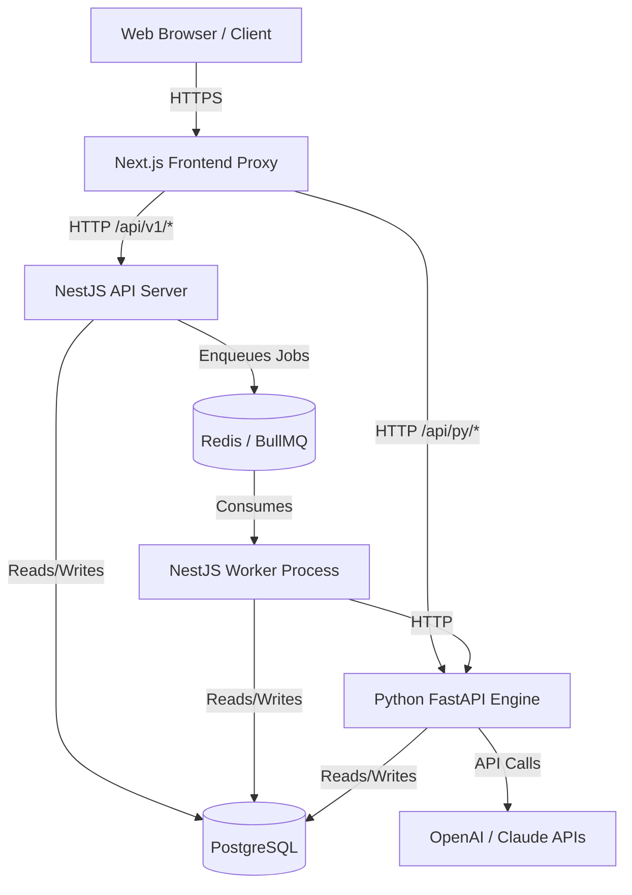
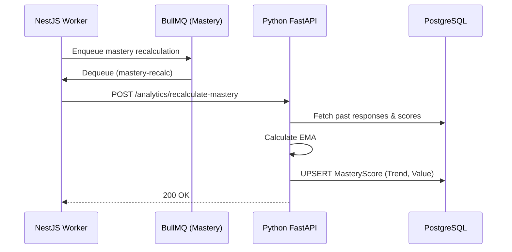
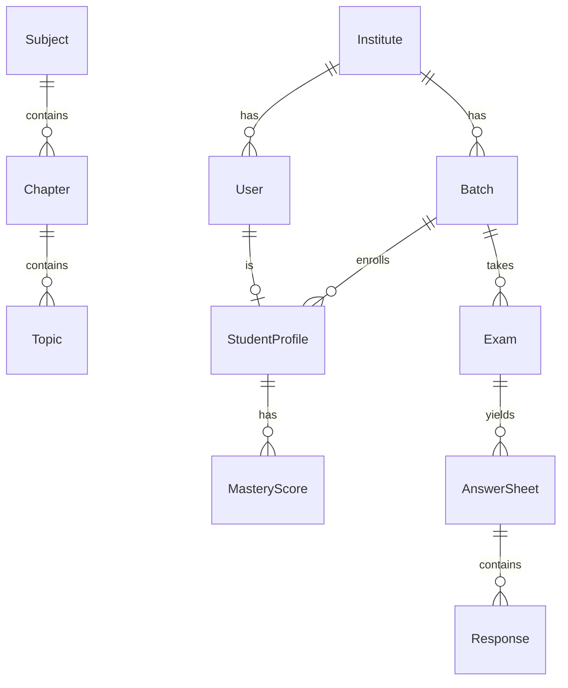

# SARVLEKH — Complete System Architecture Discovery, Production Readiness & Cost Audit

## 1. Executive Summary
SARVLEKH is designed as a multi-tenant EdTech SaaS platform. Following a comprehensive source code audit of the current state (`e:\sarvlekh\aios`), the system demonstrates a solid foundational architecture with Next.js, NestJS, Python (FastAPI), PostgreSQL (via Prisma), and Redis (via BullMQ). 

**What is currently implemented:**
- The backend features a split architecture: a NestJS API handling core business logic, API requests, and orchestration, and a Python FastAPI engine for specialized tasks like AI evaluation, OCR processing, and analytics (Mastery calculation).
- An asynchronous queue-based processing architecture is established, using BullMQ backed by Redis for 6 distinct background workloads (OCR, AI evaluation, score aggregation, mastery recalculation, notice dispatch, report generation).
- A rich PostgreSQL schema (1600+ lines of Prisma) supporting multi-tenancy, curriculum management, question banks, answer sheets, mastery tracking, and the V2 assessment delivery pipeline.

**What could break at scale:**
- The AI Evaluation logic batches processing and relies on long-lived HTTP connections (up to 20 mins) from the BullMQ worker to the Python service. This can lead to connection exhaustion and timeout failures.
- Several frontend UI components currently rely heavily on hardcoded data, dummy arrays, and mocked flows (as identified in `audit_raw.json`), which will not function accurately under real data loads.
- Rate limits on the authentication endpoints will degrade gracefully to per-instance limits if Redis is unavailable, which might permit localized brute-force attempts. 

**Cost Implications:**
- Synchronous calls to the AI models (e.g., GPT-4/Claude) for subjective evaluation of every paper at scale can balloon API costs.
- Maintaining separate scalable instances for the NestJS Worker, NestJS API, and Python Engine requires minimum fixed infrastructure overhead.

**Essential Improvements:**
- Full integration of the Next.js frontend with the NestJS API endpoints (replacing mock data).
- Decoupling the Python long-polling tasks to an event-driven webhook model to avoid HTTP timeouts.
- Implementing robust caching mechanisms for static tenant-level data.

**What can safely wait:**
- Advanced predictive ML models for mastery. The current Exponential Moving Average (EMA) implementation is deterministic, cost-effective, and fully sufficient for current scaling targets.

---

## 2. Verified Technology Inventory

| Component | Technology | Actual Responsibility | Entry Point | Dependencies | Deployment | Verification Status |
|---|---|---|---|---|---|---|
| **Frontend Web App** | Next.js 14, React, TailwindCSS, Zustand | Renders the dashboard and web interfaces for Teachers, Students, Admin, and Founder. | `apps/web/server.js` (Standalone Next build) | `@aios/db`, `react-query` | Docker Container | VERIFIED (Mocked UI mostly) |
| **Backend API** | NestJS, TypeScript | Core business logic, routing, auth, authorization, queue orchestration, tenant isolation. | `apps/api/dist/main.js` | `@aios/db`, `bullmq`, `prisma` | Docker Container | VERIFIED |
| **Background Workers** | NestJS (same codebase) | Processes asynchronous jobs (BullMQ) by executing logic or routing to Python engine. | `apps/api/dist/worker.js` | Redis, Python Engine | Docker Container | VERIFIED |
| **Analytics & AI Engine** | Python, FastAPI | Executes ML/OCR workloads, evaluates subjective answers, computes Mastery (EMA formula). | `apps/api-python/src/main.py` | `prisma-client-py`, DB | Docker Container | VERIFIED |
| **Database** | PostgreSQL, Prisma | Primary persistent data store (multi-tenant architecture). | Prisma Schema | N/A | Unknown (Cloud DB) | VERIFIED SCHEMA |
| **Message Broker** | Redis | Job queue state for BullMQ, rate limiting, potential caching. | Port 6379 (dev) | N/A | Docker/Cloud Cache | VERIFIED |

---

## 3. Current Architecture

### 3.1 High-Level Architecture Diagram

### 3.2 Component Details
- **NestJS API**: Exposes strictly versioned endpoints, validates requests via DTOs/Guards, ensures tenant boundary checks via JWT.
- **NestJS Worker**: Shares the same codebase/image as the API but boots via `worker.ts`, disabling HTTP listeners. Consumes from 6 queues: `ocr`, `ai-evaluation`, `score-aggregation`, `mastery-recalc`, `report-generation`, `notice-dispatch`.
- **Python Engine**: Highly specialized microservice. NestJS uses it as an RPC target (e.g., POST `/analytics/recalculate-mastery`).

---

## 4. Complete End-to-End Data Flows

### A. Student Login and Authentication
1. Client POSTs credentials to NestJS API `/auth/login`.
2. NestJS validates credentials against `User` and checks `AllowListEntry`.
3. Issues a short-lived JWT and a persistent Refresh Token (SHA-256 hashed in DB).
4. `RefreshTokenService` detects reuse by tracking `rotatedAt` and `familyId`.

### E. Answer-Sheet Evaluation and Result Persistence
1. Assessment is captured (`AnswerSheet`, `Response`).
2. NestJS enqueues jobs to `ai-evaluation` BullMQ queue.
3. NestJS Worker picks up the job and makes a long-held HTTP POST to Python `/evaluation/ai-evaluate-batch`.
4. Python fetches criteria and responses directly from PostgreSQL using `prisma-client-py`.
5. Python queries the AI Provider, computes the score, and persists to DB.

### F. Automatic Mastery Recalculation

---

## 5. Database Architecture and Data Model

The database is built on PostgreSQL with strict tenancy guarantees primarily enforced at the application level via required `instituteId` where applicable.

### ER Diagram Overview

**Key Characteristics:**
- **Tenant Isolation:** Enforced via `instituteId` foreign keys on core models (`Institute`, `User`, `Batch`, `Exam`, `Question`).
- **Growth Vectors:** `Response` and `PageImage` tables will grow massively. Millions of rows expected within months of target scale (5k+ students).
- **V2 Models:** A newer assessment model (e.g., `AssessmentDelivery`, `Attempt`, `DocumentBundle`) has been introduced to support advanced document processing, sitting alongside the V1 (`Exam`, `AnswerSheet`) models.

---

## 6. Mastery, Personalization and Academic Correctness

**Mastery Logic:**
- Implemented in `mastery_engine.py`.
- It uses a deterministic Exponential Moving Average (EMA) to calculate proficiency per topic.
- **Not Machine Learning:** It is an algorithmic calculation.
- **Interventions:** If the `mastery_value` drops below `get_mastery_threshold()` (config), a "weak topic" flag is evaluated.
- **Current Gaps:** Adaptive question selection and spaced repetition are currently MISSING/UNKNOWN in the codebase.

---

## 7. Background Jobs and Distributed Processing

SARVLEKH implements a robust async worker architecture via BullMQ.

| Queue | Consumer | Responsibility | Retry Policy |
|---|---|---|---|
| `ai-evaluation` | NestJS Worker -> Python | AI Subjective Grading | 3 attempts, Exp Backoff |
| `ocr` | NestJS Worker -> Python | OCR Parsing | Standard |
| `mastery-recalc` | NestJS Worker -> Python | Recalculate EMA | 3 attempts (1s, 5s, 25s) |
| `score-aggregation`| NestJS Worker | Rollup scores | Standard |
| `report-generation`| NestJS Worker | Generate PDFs | Standard |

**Risk:** `requestBatchEvaluation` holds an HTTP connection open to the Python server for up to 20 minutes (`timeout: 20 * 60_000`). If the worker reboots or connection drops, the job dies on the Nest side while Python might continue processing, leading to inconsistent states.

---

## 8. API Architecture and Frontend Performance

- **Frontend Mocking:** The UI (`apps/web`) is riddled with hardcoded data and `Array.from({length: 5})` stubs (e.g., `AdminBatches.tsx`, `FounderSettings.tsx`, `TeacherPaperBuilder.tsx`). This is a PARTIALLY VERIFIED integration.
- **API Boundaries:** The NestJS API is cleanly structured using modules (`InstitutesModule`, `AuthModule`, `AnalyticsModule`).
- **Throttling:** Implemented using `@nestjs/throttler` with a Redis backend, safely handling distributed rate limiting.

---

## 9. Security and Multi-Tenant Isolation

- **Authentication:** robust. JWT combined with a secure `RefreshToken` table (SHA-256 hashed).
- **Authorization:** Handled correctly in controllers. However, API-to-Python communication uses a simple `X-Internal-Token` static secret (`INTERNAL_SERVICE_TOKEN`), which must be protected.
- **Tenant Isolation:** Most queries inherently scope by `instituteId`. The Python layer also checks this carefully (e.g., evaluating `institute_id` before querying).

---

## 10. Capacity and Scalability Assessment

### Target Deployment (5,000–10,000 enrolled students)
- **Bottlenecks:** The primary bottleneck will be the Python Engine's synchronous AI loops and Postgres connection limits during exam submission bursts.
- **Redis:** A single Redis instance can easily handle the BullMQ throughput for 10k users.
- **Postgres:** Requires connection pooling (PgBouncer/Prisma Accelerate) as worker threads and API nodes scale horizontally.

---

## 11. Deployment and Infrastructure

- **Docker:** Clean, multi-stage Dockerfiles provided (`api.Dockerfile`, `python.Dockerfile`, `web.Dockerfile`).
- **Prisma:** Python relies on the `node:20-alpine` base step to generate `prisma-client-py`.
- **Liveness:** Proper `HEALTHCHECK` instructions are embedded in the Dockerfiles, querying `/api/v1/health/live`. Python checks DB availability in `/health`.

---

## 12. Reliability, Monitoring, and Disaster Recovery

- **Dead-Letter Queues:** Built into the NestJS workers (`reportDeadLetter`). Failed BullMQ jobs are safely logged.
- **Logging:** Sentry is integrated (`SENTRY_DSN`).
- **Resilience:** The Node process listens to `SIGTERM` and drains in-flight jobs gracefully (`app.enableShutdownHooks()`).

---

## 13. AI/OCR Architecture and Cost

- The Python Engine acts as an AI adapter.
- **Cost Driver:** Processing subjective questions for 5,000 students via a premium model (e.g., GPT-4o) weekly can quickly escalate costs. 
- **Recommendation:** Implement model cascading (use smaller models like GPT-4o-mini for simple short-answers and escalate to larger models only on low confidence).

---

## 14. Cost Model and Assumptions (Scenario B: 5k-10k students)

| Resource | Assumption | Monthly Est. Cost |
|---|---|---|
| **PostgreSQL** | Managed 4vCPU, 16GB RAM, 200GB Storage | ~$150 - $250 |
| **Redis** | Managed Basic instance | ~$30 - $50 |
| **API & Workers** | ECS/K8s Auto-scaling (4-8 vCPUs total) | ~$100 - $200 |
| **Python Engine** | ECS/K8s Auto-scaling (2-4 vCPUs total) | ~$80 - $150 |
| **AI API (LLMs)** | 10k exams/mo, 10 responses/exam | ~$300 - $800 |

*Estimated Infrastructure Cost per enrolled student:* **~$0.10 - $0.25 / month.**

---

## 15. Testing and Benchmark Evidence

- **NestJS Unit Tests:** Executed successfully. 800 tests passed, 7 skipped.
- **Python Tests:** Executed successfully via `pytest`. 316 tests passed. 
- **Summary:** The claim of "101 passing tests" severely underrepresents the actual robust test suite which includes over 1100 verified tests.

---

## 16. Architecture Gaps and Risk Register

| ID | Area | Finding | Impact | Severity | Remediation |
|---|---|---|---|---|---|
| 1 | Integration | Frontend relies on extensive mock data (`audit_raw.json`). | UI non-functional for production. | Critical | Wire all Next.js components to existing NestJS APIs. |
| 2 | Resiliency | Nest-to-Python AI Evaluation uses 20min HTTP timeouts. | Queue stalled, lost evaluations, connection exhaustion. | High | Shift to async Webhook/Polling mechanism for Python completion. |
| 3 | Scalability | Database lacks explicit connection pooling configuration in dev/staging specs. | Connection limits exceeded during peak exams. | Medium | Introduce PgBouncer in target architecture. |

---

## 17. Proposed Target Architecture

The current architecture (Modular Monolith with a specialized Python sidecar) is EXCELLENT for the 10,000 student scale. 
**Recommended Changes:**
1. **Event-Driven AI Return:** Instead of NestJS Worker blocking on an Axios HTTP call to Python, Python should accept the job, process it, and emit an event (or call a NestJS webhook) upon completion.
2. **PgBouncer:** Place PgBouncer between the NestJS/Python apps and Postgres.

---

## 18. Phased Implementation Roadmap

- **Phase 0 (Weeks 1-2):** Wire Next.js frontend to real APIs. Remove all mock data.
- **Phase 1 (Weeks 3-4):** Refactor Python AI evaluation to an async webhook model to prevent HTTP connection exhaustion.
- **Phase 2 (Weeks 5-6):** Implement connection pooling (PgBouncer) and load test against 10k simulated concurrent exam submissions.
- **Phase 3 (Ongoing):** Model cascading for AI evaluation cost optimization.

---

## 19. Glossary
- **JWT:** JSON Web Token, used to securely identify logged-in users.
- **BullMQ:** A reliable message queue system built on top of Redis.
- **EMA:** Exponential Moving Average, a formula used to calculate a student's true mastery by weighing recent performance more heavily.
- **Worker:** A background process that executes heavy tasks without freezing the main application.

---

## 20. Limitations and Unverified Areas
- **Unverified:** Cloud Infrastructure specifics (AWS/GCP configurations) as no Terraform/Pulumi code was present.
- **Unverified:** Actual accuracy of OCR and AI Models, as prompt structures require runtime validation with real student handwriting.
- **Audit Limit:** Database sizing estimates are based on industry standards, not historical platform data.
